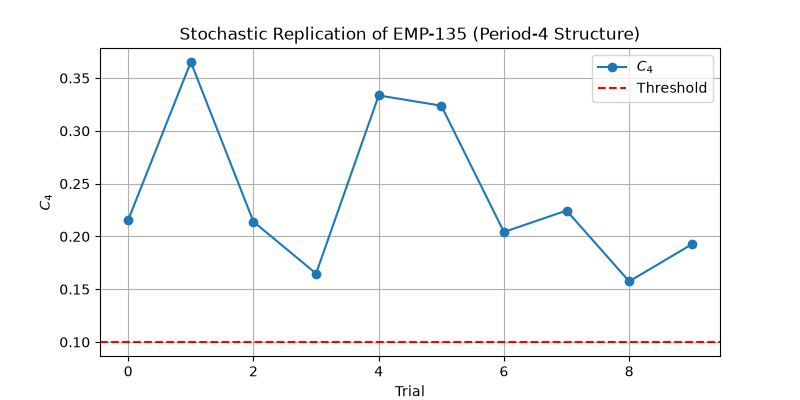

# Stochastic Replication of EMP-135 (Period-4 Structure)

## Parameters
- r: 3.865
- ε: 0.132
- N: 100
- T: 2000
- Trials: 10

## Results

- Mean $C_4$: 0.240
- Std $C_4$: 0.070
- Trials above threshold ($C_4 > 0.1$): 10/10

## Interpretation
✅ **Period-4 structure is robust to stochastic initialization.**
EMP-135's results are **reproducible** across trials.
