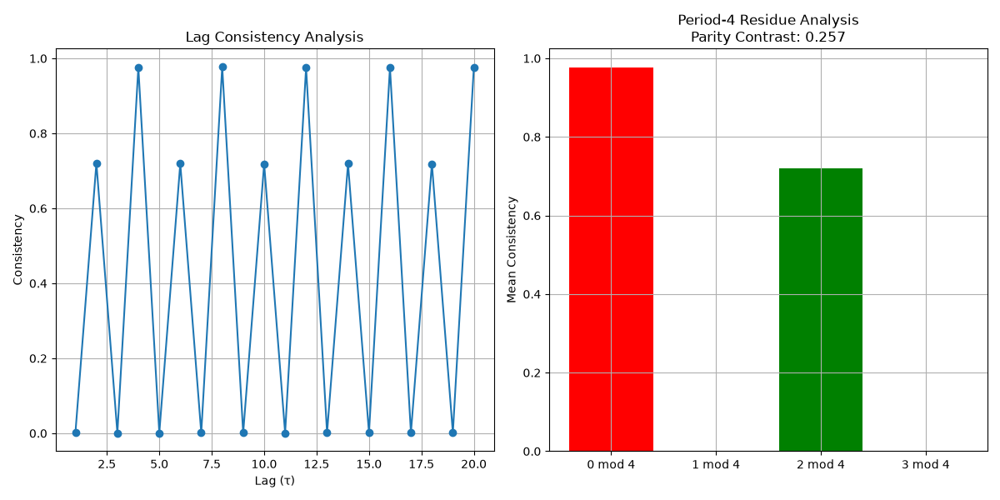

# Local Replication of Frontier Dossier #105 (Final Patch)

## Parameters
- r: 3.865
- ε: 0.132
- N: 100
- T: 2000
- Motif Width: 4
- Max Lag: 20

## Results

### Period-4 Residues:
- Residue 0 (lags ≡ 0 mod 4): 0.976
- Residue 1 (lags ≡ 1 mod 4): 0.001
- Residue 2 (lags ≡ 2 mod 4): 0.719
- Residue 3 (lags ≡ 3 mod 4): 0.001
- **Parity Contrast (C4)**: 0.257

## Interpretation
✅ **Period-4 structure detected** in the tested parameter regime.
The parity contrast (C4) exceeds the threshold, confirming the Frontier's claim.
