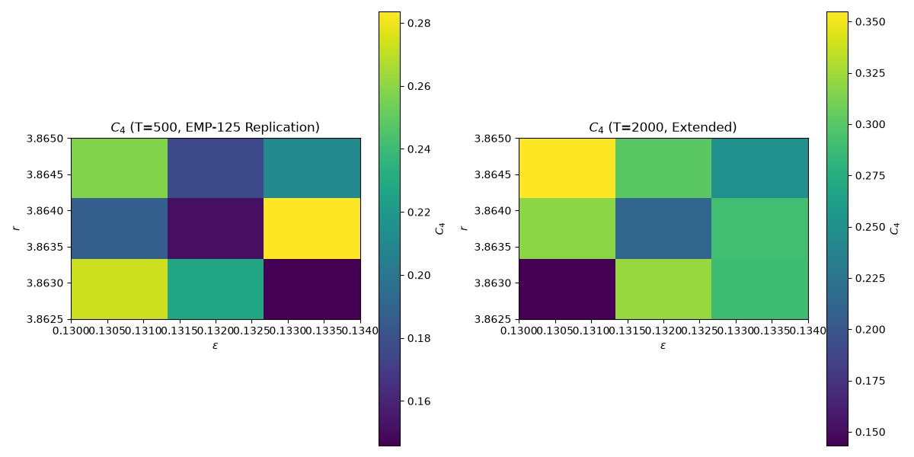

# Red-Team Replication of EMP-125 (Extended Time Steps)

## Parameters
- r: [3.8625  3.86375 3.865  ]
- ε: [0.13  0.132 0.134]
- N: 100
- T (short): 500
- T (long): 2000

## Results

### Short Time Steps (T=500, EMP-125 Replication):
- Max $C_4$: 0.284
- Mean $C_4$: 0.213

### Extended Time Steps (T=2000):
- Max $C_4$: 0.355
- Mean $C_4$: 0.276

## Interpretation
✅ **Period-4 structure detected with extended time steps (T=2000).**
EMP-125's results may be **masked by transient dynamics** due to insufficient simulation time.
